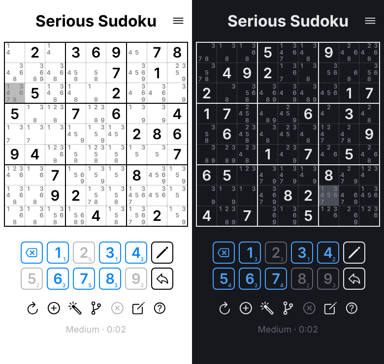
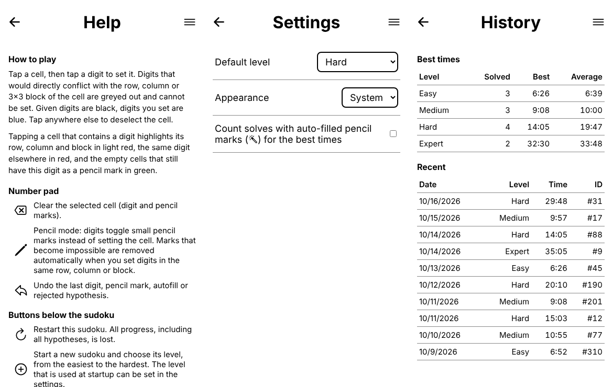

# Serious Sudoku

Serious Sudoku is a game of sudoku written in TypeScript as a mobile app.
Let's you solve the hardest sudokus by hand with depth-first search.
It allows you to guess a number and continue solving while being able to
return to the point of guessing. This process can be done in a nested way.
Try it at [chrisbaumann.ch/serious-sudoku](https://chrisbaumann.ch/serious-sudoku/), a screenshot (light and dark mode) is shown below.



The menu in the header opens the help, the settings and the history of your
solve times (light mode shown, the dark mode is available in the settings):



More instructions can be found in a blog post [here.](https://chbauman.github.io/info/2020/03/25/sudoku-ts/)
Can you solve the one below? It was [devised by Arto Inkala, a Finnish mathematician,
and is specifically designed to be unsolvable to all but the sharpest minds.](https://www.telegraph.co.uk/news/science/science-news/9359579/Worlds-hardest-sudoku-can-you-crack-it.html)


## Implementation

Built upon simpler JavaScript version found at https://github.com/baruchel/sudoku-js.
The icons are open source (Ionicons, MIT) and taken from https://ionicons.com/; they are inlined in `src/index.html`.

## Level files

The sudokus are in `assets/data/ext_lvl_<level>.txt` (levels 0 to 6: Beginner, Easy, Medium, Hard, Expert, Master and Grandmaster, see
`LEVEL_NAMES` in `src/sudoku.ts`), one per
line in the format of the generator in [sudoku-cpp](https://github.com/chbauman/sudoku-cpp):
`<description>;<puzzle>;<solution>`, where puzzle and solution are the 81
space separated cell values (0 = empty) and the description is
`<level>,<number of givens>,<digit frequencies>`.

The level is the level of the generator (see the difficulty level section of
the sudoku-cpp README): level 0 (Beginner) can be solved with only two rules
(a number that fits in only one cell of a square, the last empty cell of a row or
column), level 1 (Easy) with the basic rules (also a cell with one candidate left
and a number that fits in only one cell of a row or column). Level 2 (Medium) can
be solved without any guess, the others need nested guesses (the depth of the
search tree when guessing a cell with n candidates or a number that fits in n
cells of a row, column or square, with the smallest n). Level 6 (Grandmaster),
which holds everything from the level 6 of the generator on, is the hardest. All
sudokus have a unique solution and no given can be removed.

The files are built from collections of the sudoku-cpp generator with

```
$ node scripts/make-levels.mjs path/to/generated_dat.txt [more.txt ...]
```

which removes duplicates and puts all levels above the top level into the top
level (`TOP_LEVEL` in the script, to be kept in sync with `MAX_LEVEL` in
`src/sudoku.ts` and the number of files in `src/sw.js`; the tests check the
files). Each loaded puzzle is shuffled (digits, rows within their
bands, columns within their stacks, bands, stacks, transposition), which keeps
its level.

## Menu, pages and settings

The hamburger menu in the header opens the Help, Settings and History pages. The pages are sections of the single
`index.html`, selected by the URL hash (`#help`, `#settings`), so the browser and
Android back buttons work and the game state is kept while a page is open.
Settings (stored like the saved game, see `src/settings.ts`): the level that is
loaded when there is no saved game, the appearance (system / light / dark) and
whether solves with auto-filled pencil marks (the magic wand) count for the
best times (off by default).

In the Android app the back button / gesture closes the open dialog or menu,
returns from a page to the game and only closes the app from the game. This
needs the Capacitor App plugin (`@capacitor/app`), which is not part of the
Capacitor core; it is called through the bridge in
`setupAndroidBack` (`src/pages.ts`).

Each digit button shows how many of its digit are set in the grid, and the
digit is crossed out when all nine are set. Below the buttons the level of the
sudoku is shown next to the solving time.

Clicking anywhere deselects the selected cell, except on dialogs and the
buttons that open them, the header buttons and menu, and the digit pad (the
digit buttons also react between them).

## History (personal leaderboard)

The time to solve a sudoku (only the time the game page is visible, restarting
the sudoku restarts the clock), the level, the puzzle ID (`<level>-<line in the
level file>`), the sudoku itself as it is in the level file (81 digits, 0 =
empty, before it is shuffled, so that the solves can be rated again if the
levels change) and whether the pencil marks
were filled in automatically (the magic wand) are stored when you finish a
sudoku without the solver; custom sudokus are not recorded. The History page
shows the best and average time per level and the 10 most recent solves; solves
with the magic wand are marked there and only count for the best and average
times if the setting says so (they are always stored). The win dialog congratulates
(a short message, the next level to try) and shows the time and whether it is a new best. The data stays on the device (same
storage as the saved game, see below), there is no server; the last 500 solves
are kept.

## Saved game

The current game (digits, pencil marks and hypotheses) is stored in the
browser's `localStorage` (in the Android app additionally in the native
Preferences, see `src/storage.ts`: the WebView writes `localStorage` to disk
lazily, so a game could be lost when the app was swiped away right after a
move) after every move, so reloading the page (easily done
by accident on mobile) continues where you left off. Solving a sudoku, loading
a new one or clearing the site data starts a fresh game. The undo history is
not saved.

## Keyboard shortcuts

| Key | Action |
| --- | --- |
| Arrow keys | Move the selected cell (starts at the top left) |
| `1`-`9` | Enter the digit (or toggle the pencil mark in pencil mode) |
| `Delete` / `Backspace` / `0` | Clear the selected cell |
| `Ctrl`/`Cmd` + `Z` | Undo (digits, pencil marks, autofill, hypothesis rejection) |

## Development

Requires `Node.js`. Everything is run through npm:

```
$ npm install     # install dependencies
$ npm run build   # compile TypeScript to dist/
$ npm run watch   # recompile on changes
$ npm start       # build and serve at http://localhost:8080/src/index.html
$ npm run dev     # watch + serve
$ npm test        # run the jest tests
```

The port may differ if 8080 is already in use.
The local dev server does not register the service worker (see below).

## Deployment

Pushes to `main` trigger `.github/workflows/deploy.yml`, which runs the tests,
builds the TypeScript (`dist/` is not committed) and publishes the site to the
`gh-pages` branch (site root = `src/` contents plus `dist/` and `assets/`).
In the repository settings, set Pages to deploy from the `gh-pages` branch
(root). The page is then available at the default GitHub Pages address,
<https://chrisbaumann.ch/serious-sudoku/>. All paths are relative, so it works
under the `/serious-sudoku/` sub-path.

## Installable / offline (PWA)

The deployed page is an installable web app (`src/manifest.webmanifest`) and
works offline: `src/sw.js` is a service worker that precaches the app, the
icons and all level files. On deploy the cache name gets the commit hash, so
every release replaces the cached version. The service worker is not
registered when the page is served from `/src/` (local dev), so changes show
up immediately while developing.

## Android app

The Android app is a thin [Capacitor](https://capacitorjs.com) wrapper around
the same web app: `npm run assemble` builds the site into `_site/` (the same
step that is deployed to GitHub Pages) and `npx cap sync android` copies it
into the Android project in `android/`. There is no separate Android code to
maintain; the app works offline because all files are bundled.

The workflow `.github/workflows/android.yml` builds a debug APK on every push
to `main` and for pull requests that touch the app (Actions run -> Artifacts ->
`serious-sudoku-debug-apk`). The APK is named after the app and the build, e.g.
`serious-sudoku-1.0-build57-1a2b3c4-debug.apk`. To install it, copy it to the phone and open
it (allow installing from unknown sources). To build locally you need Node 22,
JDK 21 and the Android SDK:

```
$ npm run assemble
$ npx cap sync android
$ cd android && ./gradlew assembleDebug   # android/app/build/outputs/apk/debug/serious-sudoku-1.0-local-debug.apk
```

All debug APKs (CI and local) are signed with the same debug key,
`android/app/debug.keystore` (committed on purpose, it is not a secret), so a
debug APK can be installed over an older one, which keeps the app data (saved
game, history, settings): open the new APK on the phone or run
`adb install -r serious-sudoku-*-debug.apk`. Switching to a release build (other
signing key) needs an uninstall once, which deletes the app data.

The data in the browser and in the app is stored under the keys `serious-sudoku:settings:v1`,
`serious-sudoku:history:v1` and `serious-sudoku:game:v1`.

In CI the version code of the APK is the run number of the workflow and the
version name shows it with the commit (`1.0 (build 57, 1a2b3c4)`, see the app
info of the phone), so each CI build is newer than the one before. Local
builds have the version code 1; installing one over a CI build is a downgrade
and needs `adb install -r -d serious-sudoku-*-debug.apk`.

A signed release bundle for the Play Store is built by the workflow
`.github/workflows/android-release.yml`; the setup and the store listing material
are described in [`docs/play-store/`](docs/play-store/README.md).
